# Wissen Code demo and testing guide

Demo date: **19 November 2026**.

Choose one environment for the whole demo: local http://localhost:3000 or deployed https://wissen-code.vercel.app. Registration, login, assessments and interview assignments must all use that same environment/database.

## Demo login and registration credentials

The administrator credentials below were supplied by you. They have not been tested against the local or deployed system during this documentation update. No account or password was changed.

| Role                                     | Email                                                    | Password        | How to use                                                                                                                            |
| ---------------------------------------- | -------------------------------------------------------- | --------------- | ------------------------------------------------------------------------------------------------------------------------------------- |
| Admin                                    | avrut.patel@wissen.com                                   | Wissen@51510    | Log in with the existing account; do not register again                                                                               |
| New candidate                            | Fresh real email controlled by the demo candidate        | Candidate@123   | Register first, then log out and log in with exactly the same email/password                                                          |
| New interviewer, if demonstrating signup | Different fresh real email controlled by the interviewer | Interviewer@123 | Register as Interviewer if offered; otherwise have the admin invite the interviewer and set this password through the invitation link |

Password spelling and case are exact: **Candidate@123** and **Interviewer@123**. The role is spelled **Interviewer**.

Before tomorrow's demo, write the actual candidate/interviewer email addresses into your private presenter notes and confirm they are unused in the selected environment. Do not register these new demo addresses during rehearsal if you want to demonstrate their first registration live. Use different rehearsal addresses. After registration, use the exact same credentials throughout the assessment and interview. Do not try to register that email twice.

The following pre-existing local accounts remain fallback options. Their password hashes were checked locally on 18 November 2026; they are not verified production accounts:

| Role            | Email                  | Password        | Name        |
| --------------- | ---------------------- | --------------- | ----------- |
| Interviewer     | interviewer@wissen.dev | Interviewer@123 | David Kim   |
| Candidate       | rahul@wissen.dev       | Candidate@123   | Rahul Singh |
| Spare candidate | maria@wissen.dev       | Candidate@123   | Maria Gomez |

This file contains the administrator password you requested. Keep the presenter copy private; do not commit or publish it to GitHub. Do not display SMTP credentials, API keys, database passwords, JWT secrets or private SSH keys. Website registration does not create an administrator account.

## Before the audience joins

1. Open Docker Desktop and wait until its engine is ready. The check on 18 November found Redis unreachable; confirm it is available before rehearsal.
2. In Windows PowerShell, from the repository root:

```powershell
cd "C:\Users\Wissen\Desktop\Wissen-Code-all-new-wissen-code"
docker ps -a --format "table {{.Names}}\t{{.Status}}\t{{.Ports}}"
```

If the existing `wissen-code-redis-1` container is listed but stopped:

```powershell
docker start wissen-code-redis-1
```

If it is not listed, inspect the existing Compose setup rather than creating another Redis blindly. Also confirm the local PostgreSQL Windows service is running.

```powershell
npm run dev:check
npm run dev:all
```

Alternatively double-click `start-project.cmd`. Use one launcher, not two. Keep it open. If a port is occupied, first check whether the project is already running.

3. Open these in a browser and require a successful response before continuing:
   - http://localhost:3000
   - http://localhost:4001/api/health (note whether judgeMode is live or mock)
   - http://localhost:4001/api/ready
   - http://localhost:8765/health (require the model's ready flag, not just an HTTP response)
4. Use separate browser profiles: Chrome for admin, Edge for interviewer, and another profile/private window for the candidate registered in Step 0. Tabs in the same browser profile share login storage. Two Incognito windows in the same browser can share storage too. Do not log the same candidate into two devices.
5. Allow camera and microphone; use headphones. Test video with the exact devices/networks you will use. A second participant machine must open an HTTPS deployment, not that machine's localhost. TURN may be needed across restrictive networks.
6. Rehearse one real Judge0 execution, one AI request if presenting AI, one email to your own inbox if presenting email, and one complete PDF generation. A configured API key does not prove quota, connectivity or provider availability.
7. Prepare the two questions below, a fresh assessment, a fresh scheduled interview, and one completed results/PDF example in advance. Do not reset or delete existing results to rehearse.
8. Keep the candidate assessment tab focused. This project warns on tab switches and can auto-submit after three; do not switch away to show admin while the candidate is taking the test. Use a second machine/presenter or show admin afterward.

## Recommended live flow: about 30-40 minutes

| Stage                  | Duration    | What to show                                                                    |
| ---------------------- | ----------- | ------------------------------------------------------------------------------- |
| Introduction           | 1 minute    | Roles, assessment workflow, live interviews and reports                         |
| Candidate signup/login | 3 minutes   | Register with a fresh real email, verify if prompted, log out and sign in again |
| Admin setup            | 4 minutes   | Question bank, mixed assessment, draft and publish                              |
| Candidate test         | 5 minutes   | Instructions, editor, resizers, run, submit, results                            |
| Results                | 2 minutes   | Admin results, scores, CSV export                                               |
| Returning guest        | 3 minutes   | Same email joins another assessment without password                            |
| Session administration | 2 minutes   | Click session count, cancel then confirm logout                                 |
| Live interview         | 7 minutes   | Assigned interviewer, asked question/follow-up, shared code, feedback           |
| Interview report       | 3 minutes   | Confirm end, final feedback, PDF, admin review                                  |
| Optional AI and email  | 3-5 minutes | One small generation request and a controlled invitation                        |

Narration: "Administrators prepare assessments and assign interviews. Candidates take tests with saved answers and controlled attempts. Interviewers collaborate live and record evidence-based feedback. Results and downloadable reports bring these workflows together."

## 0. First live step: candidate registration, then login

1. Open the selected demo website in the candidate browser profile. Use Register / Create account.
2. Enter name `Demo Candidate`, the candidate's fresh real email, password **Candidate@123**, and role Candidate. Record the exact email privately.
3. If email verification is shown, retrieve the actual code from that inbox. There is no fixed/default OTP. Choose Verify later only if that option is displayed and you intend to demonstrate it.
4. Registration may sign the candidate in automatically. Show the candidate dashboard, then log out normally.
5. Open Sign in and enter the **same email** and **Candidate@123**. This demonstrates that the new account can log in independently.
6. Keep this account for all remaining candidate steps. In the sections below, replace the fallback name Rahul and email `rahul@wissen.dev` with this new candidate's actual name and email. Admin must select this new candidate when scheduling their interview.
7. For interviewer signup, use a different real email and **Interviewer@123**. Verify if prompted, then log out and sign in with the same credentials. If using the existing local David account instead, skip interviewer registration. Assign the interview to whichever interviewer account you actually use.
8. In the admin browser profile, sign in as **avrut.patel@wissen.com** with **Wissen@51510**. Rehearse this login in the selected environment beforehand; this guide does not reset or create that account.

Continue with question preparation and assessment publishing after the registration/login demonstration. Prepared questions can already exist before the audience joins.

## 1. Prepare deterministic questions

Use a fresh title suffix such as `Demo 19Nov Run01`; increment Run02, Run03 when rehearsing. Duplicate checks can reject identical titles or statements. For AI drafts, use an existing queued item or genuinely distinct content rather than repeatedly generating the same prompt.

### Coding question

Admin > Question Bank > New Question. Create this manually before the presentation:

- Title: `Demo Sum Two Integers - Run01`
- Type: Coding; difficulty: Easy; tags: integers, arithmetic
- CPU time: 2 seconds; memory: 256000 KB
- Language/starter: Python (71)
- Statement:

```text
Read two integers a and b from standard input and print their sum.
Input: Two space-separated integers on one line.
Output: One integer, a + b, followed by a newline.
Constraints: -1000000 <= a, b <= 1000000.
Example input: 2 3
Example output: 5
```

Starter code:

```python
import sys


def solve(a: int, b: int) -> int:
    # Implement the sum here.
    return 0


if __name__ == "__main__":
    a, b = map(int, sys.stdin.buffer.read().split())
    print(solve(a, b))
```

Enter these in the question's Test Cases tab; `sum-test-cases.json` contains the same data if a JSON editor is being used. Do not assume the manual form has a JSON import feature.

| Input              | Expected output | Visibility |
| ------------------ | --------------- | ---------- |
| `2 3`              | `5`             | Sample     |
| `-4 9`             | `5`             | Sample     |
| `0 0`              | `0`             | Hidden     |
| `-7 -8`            | `-15`           | Hidden     |
| `1000000 -1000000` | `0`             | Hidden     |

Correct solution: replace `return 0` with `return a + b`. The full working program is in `sum-solution.py`. Do not print prompts such as "Enter a number", Markdown fences, or extra labels. Do not submit a bare function without the stdin/stdout driver. Use only small integers and standard Python; no packages or files are required.

### MCQ

- Title: `Demo Python FIFO - Run01`
- Difficulty: Easy
- Statement: `Which data structure processes elements in first-in, first-out (FIFO) order?`
- Choices: Stack / Queue / Set / Binary search tree
- Correct choice: Queue; select single-answer mode.
- Default assessment marks: 1.

## 2. Admin creates assessment A

1. Sign in as admin and show the dashboard and question bank.
2. Create `Demo Assessment A - Run01`.
3. Select exactly the coding question and MCQ above.
4. Configure question count 2, types Coding and MCQ, duration 30 minutes, maximum attempts 1, passing score 60%, results visible, shuffling off, allowed language Python.
5. Keep allowed email restrictions empty for the general demo. For a recipient-specific emailed invitation, use the actual inbox recipient, not a seed account mailbox.
6. Leave schedule fields empty if supported. Otherwise choose a start before the demo and an end at least two hours after it; do not use an old fixed date.
7. Show Review, save draft, then Publish. Explain that the coding question has 10 marks and MCQ 1; both correct yield 11/11. With this weighting, only the MCQ correct does not pass.
8. Prepare `Demo Assessment B - Run01` with the same settings for the returning-guest demonstration. Fresh assessment IDs matter; renaming A is not a new assessment.

## 3. Candidate runs and submits

1. In the candidate browser profile, sign in as Rahul. Open assessment A; review instructions and click Start Assessment once.
2. Answer the MCQ with Queue.
3. Open coding question; select Python. Drag the question/editor divider left/right and editor/output divider up/down.
4. Replace the starter's `return 0` with `return a + b`. Run sample cases first.
5. Optionally select custom input and use exactly `2 3`; expected stdout is `5`.
6. Confirm the answer if required, then Submit Test. Wait for grading; the separate grading worker can make results briefly pending.
7. Explain sample versus hidden tests. Return to admin only after submission; open results and download CSV. Use the displayed actual result rather than promising a score before grading finishes.
8. Reopen A: with one allowed attempt, it must not create a second attempt. Use the same session to inspect the completed result.

## 4. Returning guest demonstration

Use an entirely fresh guest email per rehearsal, such as `demo.guest.run01@example.invalid`. This address is for a copied general sharing link only; it cannot receive email. Increase the suffix on each rehearsal. If sending an email invitation, use a real inbox you control and its exact recipient-specific link instead.

1. Copy a general assessment A sharing link and open it in a separate browser profile with no logged-in user.
2. Enter name `Demo Guest Run01` and the fresh email. Continue, start, answer and submit A.
3. Log the guest out deliberately after submission.
4. Open the distinct B invitation and enter the same name/email. It should enter B without a password because B is new for that candidate.
5. A fresh unauthenticated entry into A remains blocked. Existing assessment-scoped sessions can only access their own assessment. Do not claim this verifies mailbox ownership; OTP is not part of this flow.
6. Do not close the browser or clear storage midway through a guest's assessment: same-assessment recovery without the original session is not implemented. Admission is recorded on Continue, even before Start Assessment.

## 5. Admin revokes a spare session

1. In a spare candidate browser profile, log in as Maria. Do not start a test.
2. In admin Team Access search `maria@wissen.dev`. Click her nonzero Active sessions count.
3. Show Cancel first; verify no logout. Click again and confirm Log out all devices.
4. On Maria's next authenticated request, access is rejected. Log in again using Candidate@123; no reset is needed.
5. Explain that sessions are revoked and the account, deadlines, answers and results remain. Do not demonstrate this on the guest or an ongoing live test.

## 6. Live interview and report

1. Admin creates a fresh interview `Demo Python Interview - Run01`, selects Rahul and assigns David Kim (`interviewer@wissen.dev`). Use 30 minutes. Choose immediate/flexible scheduling if supported, otherwise schedule now within the permitted starting window.
2. If resume text is useful, use: `Rahul Singh is a junior Python developer. Skills: Python, arrays, dictionaries, SQL basics. Built a task tracker with CRUD operations and input validation. Uses pytest for unit tests. Seeking a junior backend role.` Treat this as fictional demo data.
3. In the interviewer profile, open the assigned interview. Prepare questions from the existing bank instead of relying on generation. Add the sum question plus one unused lineup question.
4. Start interview and have Rahul join the candidate live room. Test microphone/camera before showing these live. On one laptop, mute one side and use headphones to avoid feedback.
5. Ask/make active the sum question using the room's question controls; check it is marked Asked. Ask a follow-up through the follow-up controls: `What is the time and extra space complexity of this solution?`
6. Candidate response: `One addition takes constant time and constant extra space for these bounded integers. The stdin parser reads the supplied input.` Type `return a + b` and show that interviewer and candidate both see code edits. Do not label an unspoken typed response as automatically transcribed speech.
7. For speech transcription, speak a clear short statement, pause, and wait for the saved transcript. Verify evidence appears before calling AI observation. Browser audio transport alone does not create transcript text.
8. Save feedback for the asked question. On Feedback, fill required criteria with evidence:
   - Communication / confidence: 4/5; `Explained the input format clearly and answered the follow-up directly.`
   - Fundamentals: 4/5; `Implemented integer addition correctly and identified constant-time core logic.`
   - Role alignment: 4/5; `Demonstrated Python stdin parsing and a straightforward solution suitable for a junior role.`
9. Get AI observation only after saving relevant skill feedback/evidence. Review it before accepting anything; no evidence means the request can be rejected.
10. Click End interview; show Keep interviewing to cancel once. Click again and confirm End interview. Then submit final feedback: overall rating 4, recommendation Hire if available, text `Solved the coding exercise correctly, handled negative values, and explained the core complexity. Recommended for the next round.`
11. After successful save, generate/download the report. Check the actual PDF contains the asked main question, asked follow-up, saved answers/evidence where available, per-question feedback, and final feedback. The extra unasked lineup question should be excluded. Do not promise missing spoken/transcribed data will appear automatically.
12. Admin opens the completed interview to review final feedback and download the report.

## 7. Optional AI studio: conservative inputs

Preflight provider quota and one complete request before the audience joins. Use only one request at a time, count 1 initially, easy difficulty, simple topic, and Python only for coding. Smaller inputs reduce ambiguity and latency but cannot guarantee a correct or available AI response.

MCQ generation fields:

- Topics: `Python lists`
- Difficulty: easy
- Type: MCQ
- Count: 1

If batch approval must be shown, request 2 MCQs only after the single-question generation rehearsal succeeded. Read their options and correct answers before approving.

Coding generation fields:

- Topic: `Add two integers from stdin and print their sum. Exactly two space-separated integers; no prompts or extra text. Python only. Bound each integer between -1000000 and 1000000. Include sample and hidden cases for positive, negative and zero values.`
- Difficulty: easy; count: 1; starter languages: Python only.

The topic guides AI but is not a guarantee of generated correctness. Inspect stdin format, expected outputs and the complete runnable starter driver. Do not use complex graphs, concurrency, SQL dialects or multiple languages for the first demo request.

Buttons differ:

- Validate through AI: reviews and performs applicable execution checks; does not itself add to the bank.
- Direct Approve (Skip AI): skips AI; some generated coding starter drivers still require execution verification.
- Approve into Question Bank: no AI/execution validation; retains basic schema, revision and duplicate checks. This does not establish correctness.

Use existing prepared questions if the provider fails or is slow. Do not repeatedly click Generate or Approve while a request is pending. Retry through the provided retry control, preserving the request ID. Never invent a successful AI result.

## Registration demonstration

Use the Step 0 registration sequence first. These inputs are for new accounts, not automatically created accounts:

| Field    | Candidate signup                       | Interviewer signup if enabled                    |
| -------- | -------------------------------------- | ------------------------------------------------ |
| Name     | Demo Candidate Run01                   | Demo Interviewer Run01                           |
| Email    | A fresh real inbox/address you control | A different fresh real inbox/address you control |
| Password | Candidate@123                          | Interviewer@123                                  |
| Role     | Candidate                              | Interviewer                                      |

Use new addresses for each run to avoid Email already exists. A seed `.dev` email or `example.invalid` address cannot be used to demonstrate receiving OTP. Obtain the actual OTP from the inbox; there is no default code. If the screen offers Verify later you may demonstrate that choice explicitly. Otherwise finish verification. Existing seed accounts need login, not registration. A newly registered interviewer must be assigned an interview; it will not inherit David's assignment. Guests have no usable default password.

## Testing acceptance checklist

| Check                            | Expected result                                                                       |
| -------------------------------- | ------------------------------------------------------------------------------------- |
| Valid seed logins                | Each reaches the appropriate role workspace                                           |
| Invalid password                 | Rejected without creating a session                                                   |
| Signup with existing email       | Rejected without duplicate user                                                       |
| Missing/invalid question data    | Field error; no partial bank entry                                                    |
| Mixed assessment                 | Coding + MCQ, correct configured question count                                       |
| Correct sum                      | All five cases pass under a real judge                                                |
| Hidden cases                     | Inputs/expected outputs not exposed as samples to candidate                           |
| Autosave                         | Saved indicator; refresh retains work in the same valid session                       |
| Submit                           | One completed attempt; grading eventually completes                                   |
| Repeated start/submit            | No extra attempt beyond configured maximum                                            |
| Guest A then B                   | Same account/email; separate unique participation                                     |
| Guest duplicate A                | Blocked without original session; no reset of results                                 |
| Recipient-specific link mismatch | Different email rejected                                                              |
| Resizers                         | Drag both dividers; keyboard arrows work; no overlap                                  |
| Role menu                        | Theme-matched menu; selected role and keyboard navigation work                        |
| Session revocation               | Cancel does nothing; confirm invalidates target tokens; other accounts stay signed in |
| Non-admin revocation             | Forbidden by backend                                                                  |
| Interview question               | Asked state and asked follow-ups are saved                                            |
| Interview ending                 | Cancel keeps interview active; confirm ends it                                        |
| Feedback/PDF                     | Saved criteria and final feedback; asked-only content                                 |
| Failed external dependency       | Show error honestly and use prepared artifacts                                        |

## Recovery during the demo

- Active session detected: admin revokes that registered account's sessions, then log in again. Do not delete the account.
- Redis unreachable: start Docker Desktop/existing Redis, rerun dev:check, then start the launcher once.
- Judge unavailable: show a previously rehearsed result and explain the live execution dependency. Mock mode simulates results and is not evidence the code actually ran.
- AI timeout/unsupported evidence: use the prepared bank question/manual feedback; retry later after confirming evidence/provider health.
- Email pending: inspect delivery status and worker logs; provider acceptance is not proof of inbox delivery. Use the copied link for the UI workflow if needed.
- Video connection failure: check permissions, correct room, device selection and network/TURN; demonstrate shared editor and room UI using prepared artifacts if media cannot connect.
- PDF failure: verify final feedback saved and interview completed; show the prepared report without claiming the current request succeeded.
- Expired/completed assessment: create a fresh assessment for rehearsal rather than changing old records or disabling attempt limits.

No real email, paid AI call, test submission, account creation, password change, or AWS change was performed while updating this guide. External integrations are not certified by the local configuration check.

## Testing flowchart

```mermaid
flowchart TD
    A[Start local services] --> B{Readiness and dependencies pass?}
    B -->|No| C[Fix DB, Redis, ports or configuration]
    C --> B
    B -->|Yes| REG[Candidate registers with fresh email]
    REG --> VERIFY[Verify email if prompted]
    VERIFY --> LOGIN[Log out and sign in with same credentials]
    LOGIN --> D[Log in as admin]
    D --> E[Prepare coding and MCQ questions]
    E --> F[Publish fresh assessment A: two questions, one attempt]
    F --> G[Candidate Rahul: open assessment and start]
    G --> H[Answer MCQ; resize panels; run sum code]
    H --> I{Judge responds successfully?}
    I -->|No| J[Show rehearsed result and record provider failure]
    I -->|Yes| K[Confirm answers and submit]
    K --> L[Wait for grading; inspect results and CSV]
    L --> M[Reopen same assessment: no extra attempt]
    M --> N[Guest with fresh email joins A]
    N --> O[Guest logs out; opens fresh assessment B]
    O --> P[Same email joins B without password]
    P --> Q[Same guest cannot create duplicate entry for A]
    Q --> R[Admin revokes a spare candidate session]
    R --> S[Old token fails; spare candidate can log in again]
    S --> T[Admin assigns fresh interview to David and Rahul]
    T --> U[Interviewer prepares lineup and starts interview]
    U --> V[Ask main question and follow-up; edit shared code]
    V --> W[Save feedback with specific evidence]
    W --> X[End interview: cancel once, then confirm]
    X --> Y[Submit final feedback; generate and download PDF]
    Y --> Z[Verify asked questions and follow-ups; admin reviews]
    D -. Optional AI branch .-> AI[Generate one easy MCQ or coding draft]
    AI --> AV[Validate through AI: inspect feedback]
    AV --> AP[Choose approval mode explicitly]
    AP --> E
```


